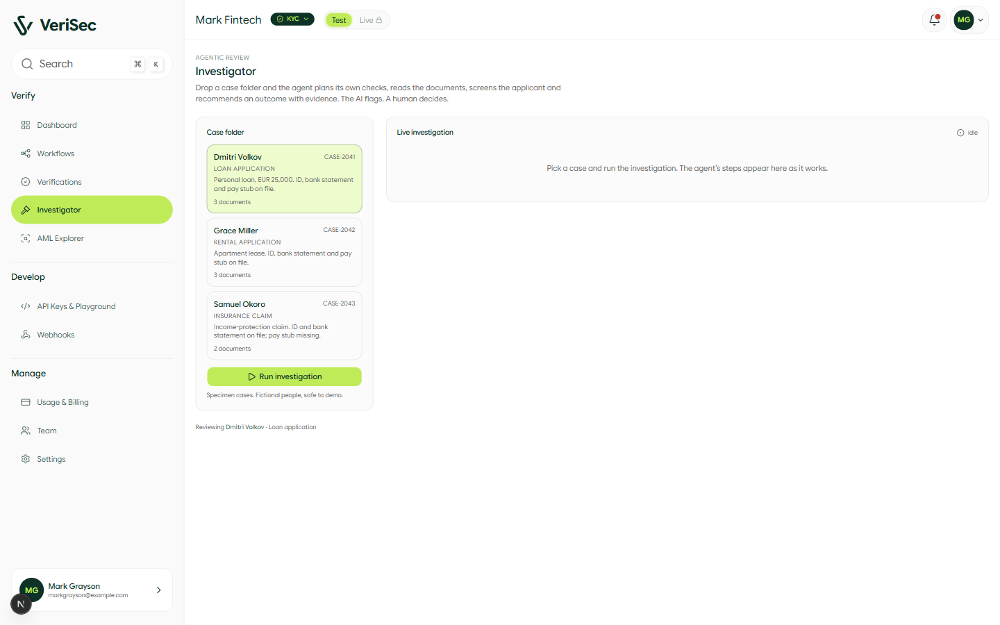
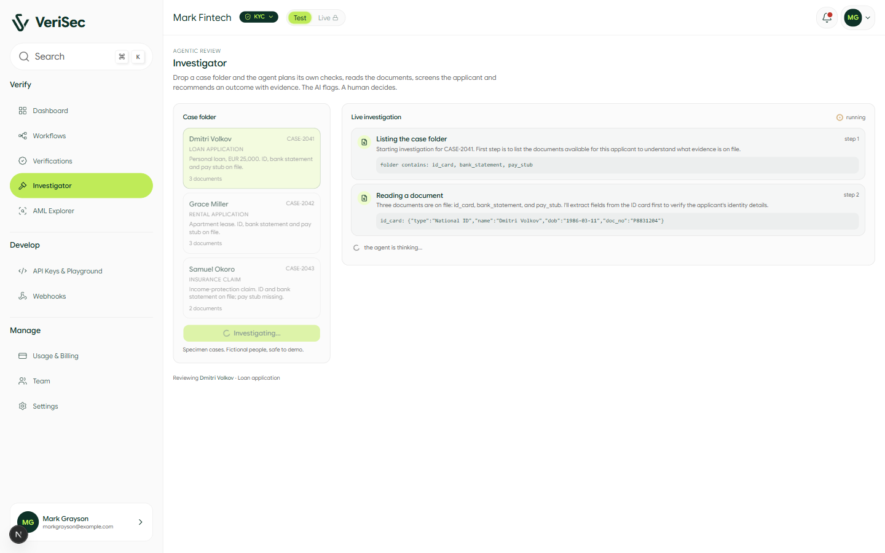
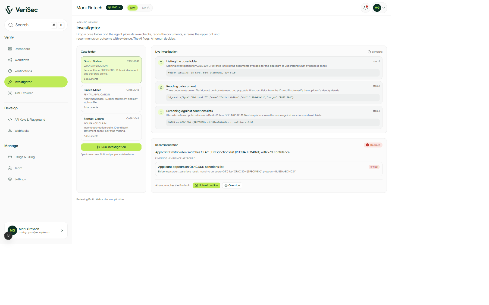

# VeriSec

Identity verification, KYC and fraud-prevention platform: a web console plus a
set of backend microservices for document capture, data extraction, screening
and verification workflows.

**The AI flags. The human decides.**

## VeriSec Investigator (agentic review)

Investigator is an AI agent inside the VeriSec console that reviews a case
folder (loan, rental or insurance) the way an analyst would:

1. **Plans** which checks to run from what is in the folder.
2. **Acts** by calling tools: read a document, screen a name against sanctions
   lists, compare stated vs verified income, compare names across documents,
   score risk.
3. **Reasons** over the results, step by step, streamed live to the screen.
4. **Recommends** approve, decline or send to review, with every finding tied
   to the exact tool result it came from. No finding without evidence.
5. **Hands the final call to a human**, who upholds or overrides it.

| Pick a case | Agent at work | Recommendation + human sign-off |
|---|---|---|
|  |  |  |

The demo ships three specimen case folders (fictional people): a sanctions hit
with inflated income (decline), a clean applicant (approve), and a name
variance with a missing pay stub (review).

### Run it

```bash
cd frontend
pnpm install
cp .env.example .env.local     # set OPENROUTER_API_KEY
pnpm investigator              # agent server on http://localhost:8799
pnpm dev                       # console on http://localhost:3000
```

Open `/investigator/`. For a local preview without the auth backend, add
`NEXT_PUBLIC_AUTH_GATE=0` to `.env.local` (never in production).

### How it is built

- The console is a static Next.js export, so the agent runs as its own small
  Node service (`frontend/scripts/investigator-server.mjs`), the same way the
  rest of VeriSec talks to separate backends. The model key stays on that
  server and never reaches the browser.
- The agent loop is real: each turn the model chooses the next tool, the tool
  runs real logic over the case data, and the observation is fed back until
  the model returns a decision. Steps stream to the UI as Server-Sent Events.
- Model: configurable with `INVESTIGATOR_MODEL` (any OpenRouter chat model).
- Case data lives in `frontend/src/lib/investigator/specimen.json`, shared by
  the UI and the agent so they never drift.

## Structure

```
backend/
  services/
    gateway/          API gateway (Go)
    console/          KYC console API: verifications, workflows, billing, team (NestJS)
    micr/             Cheque MICR extraction service
    card/             Payment-card reader service
    bin_engine/       BIN / card-metadata lookup
    scanning_common/  Shared scanning utilities
  infra/
    docker-compose.yml  Local dev stack (identity, object store, DB, webhooks)
    .env.example        Required environment variables (no secrets committed)
frontend/             Web console and verification UI (Next.js + React)
  src/app/investigator/          Investigator page
  src/components/investigator/   Live step stream, findings, human sign-off
  scripts/investigator-server.mjs  The agent service
docs/investigator/    Screenshots
```

## Running the full platform locally

1. Copy `backend/infra/.env.example` to `.env` and fill in local values.
2. Bring up the infra stack: `docker compose -f backend/infra/docker-compose.yml up -d`.
3. Install and run each service (`go run`, `pnpm start:dev`, `uvicorn`, as applicable).
4. Install and run the frontend: `cd frontend && pnpm install && pnpm dev`.

## Notes

- No secrets, private keys, model weights or runtime data are committed. Those
  are provided via environment variables and local volumes.
- `.env.example` files list every variable the stack expects.
